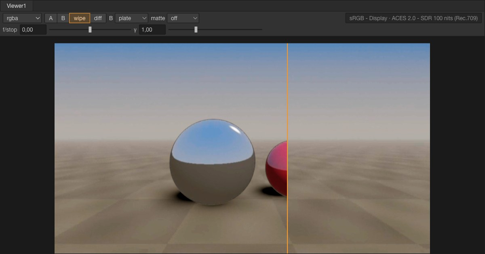

# Octane Comp — ACES

**Live browser demo: https://bertrandxipi.github.io/octane-aces-comp/**

A local, real-time GPU compositing app that integrates **Octane** EXR render passes (Beauty, Diffuse, Reflection,
Shadow, Cryptomatte) over **Fujifilm F-Log2** footage, in a strict **ACES** pipeline driven by **OpenColorIO 2**.
Nuke-inspired UI (PySide6 + ModernGL), offscreen batch rendering that matches the viewer.

- F-Log2 F-Gamut is added to the built-in ACES 2.0 studio config (Fujifilm curve + Rec.2020 primaries).
- Plate → ACEScg and ACEScg → display are OCIO-generated GLSL shaders, shared by the viewer and the batch renderer.
- Reflection gain / shadow density isolated with Cryptomatte mattes (picker), A/B, wipe and difference views.
- Settings saved as JSON; batch renders 900 frames to half-float EXR, 16-bit TIFF or ProRes.
- The web demo runs the same comp model and OCIO shaders in WebGL2, on a synthetic scene
  (passes carried in an 8-bit log-encoded video).

Contact: [WhatsApp](https://wa.me/33649111806)

Quick start: `./octacomp demo/reglages_demo.json` (creates `.venv` on first run; needs `uv` and `ffmpeg`).
The rest of this README (French) documents the original brief and the pipeline details.

## Brief d'origine

Objectif : Créer une application locale de compositing temps réel sur GPU pour intégrer des passes de rendu EXR Octane sur des rushs vidéo Fujifilm F-Log2 dans un pipeline couleur ACES strict.

Périmètre & Fonctionnalités :
1. Pipeline couleur OCIO v2 : Ingestion et conversion en ACEScg (rushs F-Log2 -> ACEScg, passes Octane -> ACEScg), application finale de l'Output Transform ACES (vers sRGB/Rec.709) sur le viewport et l'export.
2. Chargement des médias : Lecture des passes multi-canaux EXR (Beauty, Diffuse, Specular/Reflection, Shadow, etc.) et décodage des masques Cryptomatte ; chargement du rush F-Log2.
3. Moteur de compositing GPU : Shaders temps réel (OpenGL / ModernGL ou WGPU) pour recomposition de la beauty, dosage fin des ombres et reflets isolés par masque Cryptomatte sur la vidéo de fond.
4. Interface utilisateur : UI locale (PySide6 / PyQt) avec prévisualisation viewport fluide (60 fps), sliders interactifs de réglages (balance reflets, densité d'ombres, gain, masque) et inspection A/B.
5. Persistance : Sauvegarde et rechargement des réglages dans un fichier JSON.
6. Rendu batch : Commande CLI batch pour rendre offscreen la séquence complète de 900 frames avec application des réglages JSON (export EXR 16-bit half ou ProRes/TIFF).

Stack recommandée : Python 3.11+, PySide6, PyOpenColorIO (OCIO), OpenImageIO / OpenEXR, ModernGL (ou Taichi / WGPU).

Definition of Done :
- L'application se lance localement et charge sans erreur un EXR multi-passes Octane et une frame F-Log2.
- La vue temps réel applique l'Output Transform ACES et réagit instantanément aux sliders de reflets/ombres avec masquage Cryptomatte.
- Les paramètres s'exportent et se réimportent fidèlement via JSON.
- La commande batch traite les 900 frames en rendu offscreen conforme à la prévisualisation.

## Utilisation

Prérequis : macOS/Linux, ffmpeg dans le PATH, `uv`. Le premier lancement crée `.venv`.

    ./octacomp                                   # interface
    ./octacomp demo/reglages_demo.json           # interface + réglages
    ./octacomp batch demo/reglages_demo.json -o rendu/ -f exr      # EXR half ACEScg
    ./octacomp batch demo/reglages_demo.json -o rendu/comp.mov -f prores
    ./octacomp batch reglages.json -o rendu/ -f tiff               # TIFF 16 bits affiché

Jeu de test (900 frames, rush ProRes F-Log2 + EXR Octane avec Cryptomatte) :

    .venv/bin/python scripts/make_demo.py --frames 900 --size 960x540 --out demo
    .venv/bin/python scripts/conformite.py demo/reglages_demo.json demo/rendu_exr 450

### Pipeline couleur
- Config OCIO intégrée `studio-config` (ACES 2.0) + **F-Log2 F-Gamut** ajouté (courbe Fujifilm, primaires Rec.2020).
- Rush : valeurs code → ACEScg dans le shader (GLSL généré par OCIO). Passes Octane : espace réglable (ACEScg par défaut).
- Compositing en ACEScg linéaire ; Output Transform OCIO (display/view, ACES 2.0 SDR par défaut) au viewer et en sortie TIFF/ProRes.
- Le batch utilise exactement le même moteur GPU (contexte offscreen) que le viewer.

### Interface (inspirée Nuke)
Viewer (canaux, A/B, wipe, différence, f/stop, γ, display/view, lecture pixel ACEScg + objet Cryptomatte sous le curseur),
timeline (J/K/L, ←/→, Espace), Node Graph (clic = panneau), Properties : Read1 rush, Read2 EXR, Cryptomatte1,
Recompose1 (gain, diffuse, balance/teinte reflets + matte), ShadowCatcher1 (densité, couleur + matte), Merge1 (matte CG), OCIODisplay1.
Pipette Cryptomatte : bouton « Pipette » puis clic dans le viewer (Maj+clic retire). Raccourcis : F cadrer, H 1:1, W wipe, D diff, 1/2 A/B, ⌘S, F7 rendu.

### Passes reconnues
Beauty = canaux sans préfixe (ou couche beauty/rgba), `Diffuse`, `Reflection`/`Specular`, `Shadow`, Cryptomatte selon la spec (métadonnées `cryptomatte/<id>/…`).
Modèle : `cg = beauty + (k_diff−1)·diffuse + (k_refl·teinte−1)·reflection·matte`, ombre `bg·mix(1, couleur, shadow·densité·matte)`, puis over.

### Démo web (docs/)
Page statique (GitHub Pages) : `scripts/export_web.py` assemble les passes de démo en une vidéo mosaïque 3×3 et exporte
les shaders GLSL ES 3.0 générés par OCIO (`docs/ocio.js`). Le compositing tourne dans un shader WebGL2.

    .venv/bin/python scripts/export_web.py demo/reglages_demo.json --frames 360
